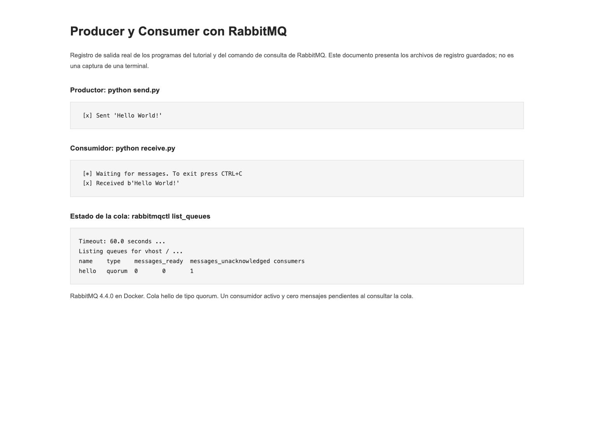
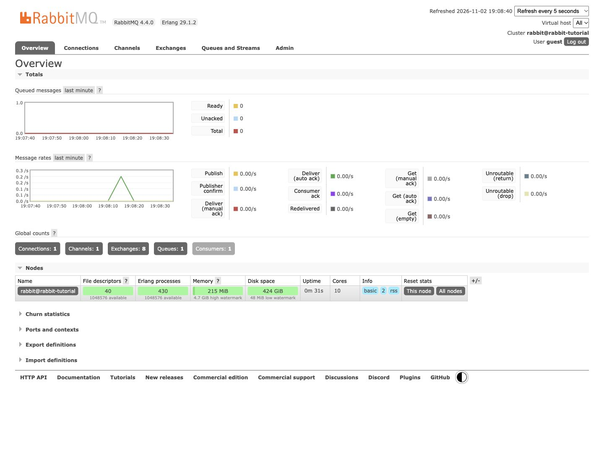
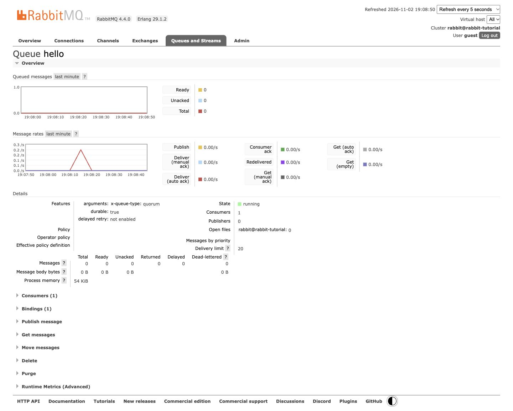

<div align="center">
  <table>
    <thead>
      <tr>
        <th>
          
        </th>
        <th>
          <strong>UNIVERSIDAD LA SALLE DE AREQUIPA</strong><br />
          <strong>FACULTAD DE INGENIERÍAS Y ARQUITECTURA</strong><br />
          <strong>DEPARTAMENTO ACADÉMICO DE INGENIERÍA Y MATEMÁTICAS</strong><br />
          <strong>CARRERA PROFESIONAL DE INGENIERÍA DE SOFTWARE</strong>
        </th>
      </tr>
    </thead>
  </table>
</div>

<div align="center">
  <h1>PRODUCER Y CONSUMER CON RABBITMQ</h1>
  <strong>Tecnologías de Construcción de Software</strong><br />
  <strong>Profesor: Luis Enrique Patiño Herrera</strong>
</div>

---

## Descripción

Recreación del tutorial oficial [RabbitMQ: Hello World! en Python](https://www.rabbitmq.com/tutorials/tutorial-one-python).

Se mantienen los programas `send.py` y `receive.py`, sus nombres y estructura, la cola `hello`, el exchange predeterminado, el mensaje `Hello World!` y la confirmación automática del consumidor. No se agregan capas de arquitectura ni se traducen las variables del tutorial, para conservar el ejemplo solicitado tal como aparece en la página.

RabbitMQ se ejecuta mediante la [imagen oficial de Docker](https://hub.docker.com/_/rabbitmq).

## Tecnologías utilizadas

[](https://www.python.org/)
[](https://pika.readthedocs.io/)
[](https://www.rabbitmq.com/)
[](https://hub.docker.com/_/rabbitmq)
[](https://www.rabbitmq.com/tutorials/tutorial-one-python)

- **Python 3** para ejecutar ambos programas.
- **Pika 1.4.4** como cliente de RabbitMQ, con versión exacta en `requirements.txt`.
- **RabbitMQ 4.4.0** como intermediario de mensajes.
- **Docker** para ejecutar RabbitMQ sin instalarlo directamente en el equipo.
- **AMQP 0-9-1** para la comunicación entre los programas y RabbitMQ.

No se requiere Node.js, npm ni una aplicación web. El logo y las insignias de este README requieren conexión para visualizarse.

## Ejecución

### 1. Preparar el proyecto

Con Docker activo y Python 3 instalado:

```bash
git clone https://github.com/iamrodrigodev/producer-consumer-rabbit-mq.git
cd producer-consumer-rabbit-mq
python3 -m venv .venv
source .venv/bin/activate
python -m pip install -r requirements.txt
```

En Windows, activar el entorno mediante `.venv\Scripts\activate`.

El tutorial propone instalar Pika con pip. Aquí se conserva una versión exacta para reproducir la instalación, sin cambiar el código del productor y consumidor.

### 2. Iniciar RabbitMQ con Docker

```bash
docker run -d --hostname rabbit-tutorial --name rabbit-tutorial \
  -p 127.0.0.1:5672:5672 \
  -p 127.0.0.1:15672:15672 \
  rabbitmq:4.4.0-management
```

En PowerShell o CMD ejecutar el comando en una sola línea.

Esperar a que RabbitMQ termine de iniciar:

```bash
docker exec rabbit-tutorial rabbitmq-diagnostics -q check_running
```

Si aún está iniciando, repetir el comando tras unos segundos. Los puertos se publican únicamente en la interfaz local. La variante `management` añade el panel de administración y conserva el servicio AMQP requerido por el tutorial.

### 3. Iniciar el consumidor

En una terminal con el entorno virtual activado:

```bash
python receive.py
```

El consumidor permanece abierto esperando mensajes:

```text
 [*] Waiting for messages. To exit press CTRL+C
```

### 4. Ejecutar el productor

En una segunda terminal, desde la misma carpeta y con el entorno virtual activado:

```bash
python send.py
```

Salida:

```text
 [x] Sent 'Hello World!'
```

En la terminal del consumidor aparece:

```text
 [x] Received b'Hello World!'
```

Python representa el cuerpo recibido como bytes; por eso aparece el prefijo `b`. Se mantiene la impresión del cuerpo tal como aparece en el bloque de código de la página del tutorial.

### 5. Consultar la cola

```bash
docker exec rabbit-tutorial rabbitmqctl list_queues name type messages_ready messages_unacknowledged consumers
```

El panel de administración está en [http://localhost:15672](http://localhost:15672), con el usuario y contraseña locales predeterminados `guest` / `guest` de la imagen.

### 6. Finalizar

Detener el consumidor con Ctrl+C. Para detener RabbitMQ sin eliminar el contenedor:

```bash
docker stop rabbit-tutorial
```

Para volver a iniciarlo:

```bash
docker start rabbit-tutorial
```

Si el contenedor ya existe, utilizar `docker start` en lugar de repetir `docker run`.

## Funcionamiento

```text
send.py → exchange predeterminado → cola hello → receive.py
```

- El productor y el consumidor abren una conexión a `localhost` mediante `pika.BlockingConnection` y obtienen un canal.
- Ambos declaran la misma cola `hello`, durable y de tipo quorum, tal como aparece en la versión consultada del tutorial. Repetir su declaración con los mismos atributos no crea otra cola.
- `basic_publish` envía el mensaje al exchange predeterminado (`exchange=''`), con `routing_key='hello'`.
- `basic_consume` registra el callback del consumidor y `start_consuming` espera entregas.
- `auto_ack=True` conserva la confirmación automática del tutorial. Es un ejemplo introductorio, sin confirmación manual de procesamiento.
- El productor cierra su conexión al terminar; el consumidor permanece disponible hasta pulsar Ctrl+C.

Se conserva la cola durable del tutorial; no se añaden propiedades de persistencia al mensaje ni confirmaciones del publicador. No se afirma una garantía adicional de entrega.

## Resultado esperado

El productor envía `Hello World!` y termina. El consumidor recibe el mismo mensaje y continúa esperando. El intercambio ocurre mediante RabbitMQ, no mediante comunicación directa entre los dos programas.

## Comprobación

Ejecutar los comandos del tutorial en dos terminales y observar la salida del productor y del consumidor. La información de la cola se obtiene mediante `rabbitmqctl` o el panel de administración.

No se incluye una suite de pruebas automatizadas: el objetivo es recrear y ejecutar el tutorial de Producer y Consumer.

## Evidencia de la ejecución

Los registros y capturas de esta sección corresponden a la ejecución local del ejemplo.

### Productor y consumidor

El productor envió `Hello World!` y el consumidor recibió `b'Hello World!'`. Los registros originales están en [productor.txt](./evidencias/productor.txt) y [consumidor.txt](./evidencias/consumidor.txt). El archivo [ejecucion.html](./evidencias/ejecucion.html) presenta esas salidas guardadas como documento, no como terminal simulada.



### RabbitMQ en Docker



### Cola hello

La cola se observó en estado `running`, tipo `quorum`, durable, con un consumidor y sin mensajes pendientes. El comando y su salida están documentados en [cola.txt](./evidencias/cola.txt). Que la cola esté vacía es coherente con la recepción; la salida del consumidor es la evidencia del contenido recibido.



El encabezado `Timeout: 60.0 seconds ...` que imprime `rabbitmqctl` indica el límite configurado del comando; la consulta terminó correctamente y devolvió la fila `hello`.
